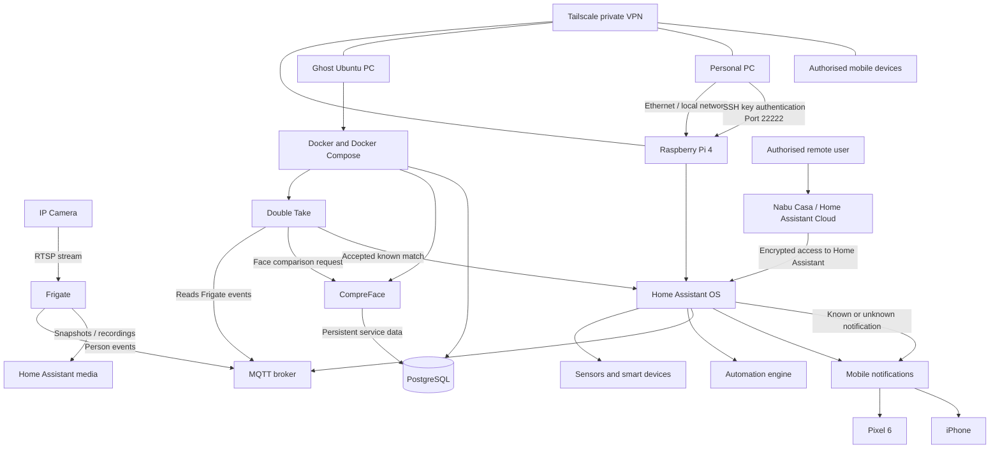

#### Raspberry Pi Home Automation and AI Surveillance

Internship project documenting a Raspberry Pi based Home Assistant system with sensors, smart-device automations, MQTT communication, Frigate AI video detection, Docker-based face recognition using Double Take and CompreFace, and secure remote access using Tailscale VPN.

## Project status
**Status:** Implemented prototype and documentation phase
The project combines a Raspberry Pi based Home Assistant system with a Docker-based AI face-recognition service hosted on an Ubuntu PC .

Frigate detects people from an IP camera stream. MQTT transfers events between services. Double Take sends relevant face images to CompreFace for recognition. Home Assistant sends a recognised-person notification when an accepted match is received and sends an unknown-person warning when no accepted match is available.

Tailscale VPN provides secure private remote access to authorised project devices without opening router ports or publicly exposing Home Assistant, MQTT, Frigate, Double Take, or CompreFace.
## Objectives

The project aims to build a local smart-home prototype that:

- Uses a Raspberry Pi as the central host
- Runs Home Assistant for device integration and automation
- Connects sensors and smart-home devices
- Uses MQTT for lightweight device and event communication
- Sends notifications to connected mobile phones
- Connects an IP camera to Frigate through RTSP
- Detects people in defined monitored zones: `place1` and `place2`
- Saves relevant snapshots
- Implements face recognition to distinguish enrolled people from unknown or unrecognised persons
- Sends different mobile alerts for recognised and unknown persons

## System architecture

# Complete System Architecture


## Current features

- Raspberry Pi 4 running Home Assistant OS
- Headless setup using Ethernet and SSH key authentication on port 22222
- Sensor and smart-device integration
- Sensor-based automations, including temperature/light control
- MQTT communication between Home Assistant, Frigate and Double Take
- RTSP IP-camera stream processed by Frigate
- Person detection and monitored zones: `place1` and `place2`
- Frigate snapshots stored in Home Assistant media
- Notifications delivered to Pixel 6 and iPhone
- Ghost Ubuntu PC hosting Docker-based face-recognition services
- CompreFace face recognition with PostgreSQL persistence
- Double Take connection between Frigate, CompreFace and MQTT
- Known identities: Melek and Rayen
- Different known-person and unknown-person notifications
- Notification tap action opens Frigate media
- Tailscale VPN private remote access for authorised devices
## Technology stack

| Component | Role |
|---|---|
| Raspberry Pi 4 | Local host for the smart-home system |
| Home Assistant OS | Central home-automation platform |
| MQTT | Publish/subscribe communication between components |
| Frigate | Local NVR and AI-based person detection |
| RTSP | IP camera video-stream protocol |
| SSH | Secure command-line administration |
| Home Assistant Companion App | Mobile push notifications |

## Documentation

- [Project overview](docs/01-project-overview.md)
- [System architecture](docs/03-system-architecture.md)
- [Network and protocols](docs/05-network-and-protocols.md)
- [Home Assistant installation](docs/06-raspberry-pi-and-home-assistant-installation.md)
- [Sensors and integrations](docs/08-sensors-and-integrations.md)
- [Automations and notifications](docs/09-automations-and-notifications.md)
- [MQTT communication](docs/10-mqtt-communication.md)
- [Frigate camera AI](docs/11-frigate-camera-ai.md)
- [Face-recognition plan and results](docs/13-face-recognition-plan-and-results.md)
- [Testing and measurements](docs/14-testing-and-measurements.md)
- [Problems, solutions, and limitations](docs/15-problems-solutions-and-limitations.md)

## Privacy and security

This repository contains **sanitised examples only**.

It does not contain:

- Camera usernames, passwords, or RTSP URLs
- MQTT passwords
- SSH private keys
- Home Assistant Cloud URLs or access tokens
- Real local IP addresses
- Family snapshots, recordings, or face-recognition training images
- Home Assistant databases or `.storage` files

## Repository structure

```text
.
├── config-examples/   # Sanitised configuration examples
├── diagrams/          # Mermaid architecture and workflow diagrams
├── docs/              # Technical documentation
├── images/            # Sanitised screenshots and diagrams only
├── results/           # Test tables and measured results
└── reports/           # Final internship report
```

## Limitations

- An unknown or unrecognised result does not prove that a person is an intruder.
- Face recognition depends on camera angle, light, face visibility, and image quality.
- The Raspberry Pi has limited processing resources, so AI features must be tested carefully.
- Remote access depends on network connectivity and the configured remote-access service.

## Privacy and security

This repository contains sanitised examples only. It does not include RTSP URLs, passwords, MQTT credentials, SSH keys, Tailscale auth keys, Home Assistant tokens, real IP addresses, camera snapshots, recordings, face-reference images, CompreFace API keys, PostgreSQL data, Docker volumes, or backups.
