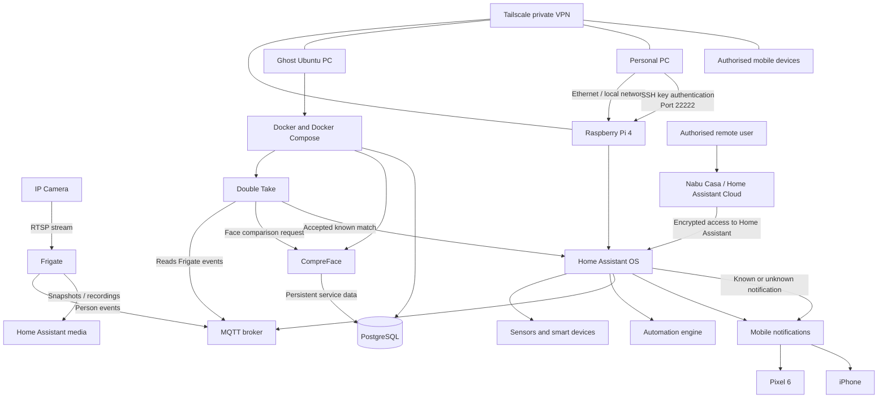

# Complete System Architecture

## Design summary

The Raspberry Pi runs Home Assistant and coordinates automations. Ghost runs the Docker-based face-recognition services. Frigate produces person events, Double Take coordinates recognition through CompreFace, and Home Assistant sends the final notification.

Nabu Casa provides managed remote access to Home Assistant. Tailscale provides a separate private VPN network for authorised project devices.