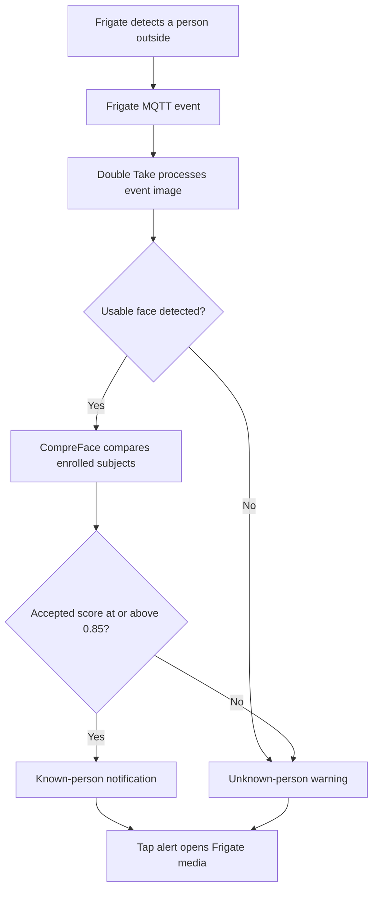

# Face Recognition Decision Flow

## Interpretation

An unknown outcome is the safe fallback. It can mean that the person is not enrolled, that the face was unclear, or that the confidence score was below the accepted threshold.