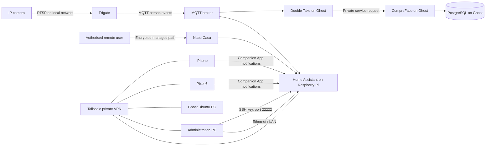

# Network Topology

## Security boundary

Camera, MQTT, Frigate, Double Take, CompreFace, PostgreSQL, Docker, and SSH remain private services. Router port forwarding and public Funnel exposure are not used in the documented design.