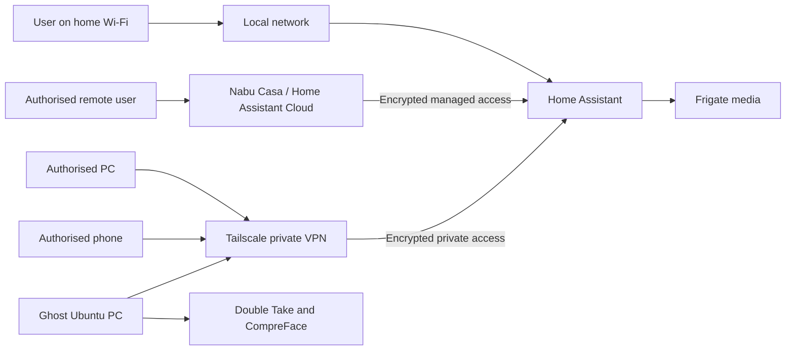

# Nabu Casa and Tailscale Remote Access

## Difference

Nabu Casa provides managed encrypted remote access to Home Assistant. Tailscale provides a private VPN between approved devices and can also provide private access to Ghost.