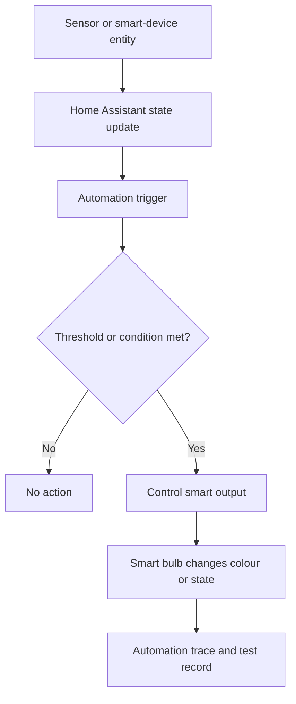

# Sensor Automation Flow

## Example

A temperature entity updates in Home Assistant. When the value reaches the configured threshold, an automation turns the selected smart bulb red as a visible warning.