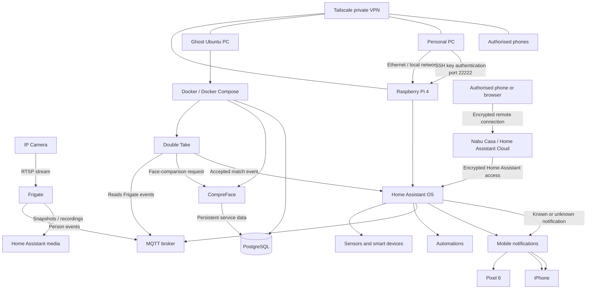

## Architecture Explanation

    | Component            | Location                         | Role                                               | Why it is used                                    |
| -------------------- | -------------------------------- | -------------------------------------------------- | ------------------------------------------------- |
| Raspberry Pi 4, 2 GB | Local network                    | Runs Home Assistant OS                             | Low-power smart-home controller                   |
| Home Assistant       | Raspberry Pi                     | Integrations, entities, automations, notifications | Central decision and control layer                |
| Sensors/devices      | Local environment                | Provide input or physical output                   | Enable smart-home monitoring and automation       |
| MQTT broker          | Local/Home Assistant environment | Publish-subscribe message exchange                 | Decouples Frigate, Double Take and Home Assistant |
| IP camera            | Outside area                     | RTSP video source                                  | Provides video for monitoring                     |
| Frigate              | Deployed camera-AI service       | Person detection, events, snapshots                | Starts the AI workflow only when needed           |
| Ghost                | Ubuntu PC                        | Docker face-recognition host                       | More suitable than the Pi for AI containers       |
| Docker/Compose       | Ghost                            | Runs isolated services                             | Reproducible, manageable deployment               |
| CompreFace           | Docker on Ghost                  | Face-recognition API                               | Compares faces with enrolled subjects             |
| PostgreSQL           | Docker on Ghost                  | CompreFace persistent database                     | Keeps application/service data after restart      |
| Double Take          | Ghost/Docker service             | Connects Frigate, CompreFace and MQTT              | Manages recognition flow and match publishing     |
| Tailscale            | Pi, Ghost, authorised devices    | Private encrypted network                          | Secure remote access without port forwarding      |
| Pixel 6/iPhone       | Mobile devices                   | Receive notifications                              | User-facing alert output                          |

## Private remote-access plane
The Home Assistant Cloud remote-access connection was enabled during the project. At one stage, the instance appeared offline in Nabu Casa; the exact cause could not be confirmed remotely. This incident is documented in the project limitations and troubleshooting sections.

Tailscale creates a private encrypted network, called a tailnet, between authorised devices. In this project, the Raspberry Pi/Home Assistant host, Ghost processing host, personal administration device, and authorised phones are members of the same private network.

This allows remote administration and Home Assistant access without exposing local services directly to the public internet. The VPN is separate from the local Ethernet/LAN path and provides secure access when the user is away from the home network.