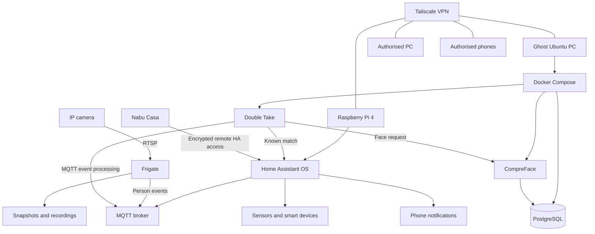

# Final Internship Report

## Raspberry Pi Home Automation and AI Surveillance

**Student:** `<name>`  
**Organisation / school:** `<organisation>`  
**Supervisor:** `<supervisor>`  
**Project period:** `<start date> to <end date>`  
**Repository:** `raspberry-pi-home-automation-and-ai-surveillance`

---

## Abstract

This internship project developed a smart-home and AI-surveillance prototype. A Raspberry Pi 4 runs Home Assistant and coordinates sensors, smart devices, automations, MQTT communication, Frigate camera events, notifications, and remote access.

An Ubuntu PC named Ghost hosts Docker-based face-recognition services. Double Take connects Frigate event images with CompreFace, while PostgreSQL provides persistent CompreFace service data. The project distinguishes enrolled known identities from unknown or unrecognised people and sends different phone notifications.

The project also documents secure remote access. Home Assistant Cloud, provided by Nabu Casa, provides managed encrypted remote access to Home Assistant. Tailscale provides a separate private VPN path between authorised devices. No ordinary router port forwarding was used for Home Assistant, MQTT, Frigate, Double Take, CompreFace, PostgreSQL, Docker, or SSH.

---

## 1. Project objective

The objective was to build and document a reproducible smart-home prototype that combines:

- Raspberry Pi based Home Assistant
- Sensors and smart-device automation
- MQTT publish/subscribe communication
- IP-camera person detection through Frigate
- Zone-based camera monitoring
- Snapshot review through Home Assistant media
- Notifications to a Pixel 6 and iPhone
- Docker-based face recognition on Ghost
- Known-person and unknown-person alert behaviour
- Secure remote access through Nabu Casa and Tailscale

---

## 2. System architecture

---

## 3. Hardware and software

| Component | Role |
|---|---|
| Raspberry Pi 4, 2 GB RAM | Runs Home Assistant OS |
| microSD card | Home Assistant operating system storage |
| Ethernet connection | Headless setup and stable local administration |
| IP camera | RTSP video source |
| Sensors and smart devices | Automation input and output |
| Ghost Ubuntu PC | Hosts Docker face-recognition services |
| Docker / Docker Compose | Runs CompreFace, PostgreSQL and related services |
| CompreFace | Face-recognition API |
| PostgreSQL | Persistent CompreFace database |
| Double Take | Bridges Frigate, CompreFace and MQTT |
| Frigate | Person detection, events and snapshots |
| MQTT broker | Event communication |
| Pixel 6 and iPhone | Notification recipients |
| Nabu Casa | Managed encrypted Home Assistant remote access |
| Tailscale | Private VPN access for authorised devices |

---

## 4. Home Assistant and sensors

Home Assistant was installed on the Raspberry Pi in a headless setup. Ethernet was used because no monitor was available. SSH key-based access was configured on port 22222, and Home Assistant OS host administration used the `ha` command-line interface where applicable.

The exact inventory of sensors and smart devices is documented in `docs/08-sensors-and-smart-devices.md`. Each device must include its entity ID, purpose, capability, automation usage, and test result.

A temperature/light automation was included as a smart-home example. When the selected temperature entity reaches the configured threshold, the configured smart bulb changes state or colour.

---

## 5. Camera and AI pipeline

The IP camera sends an RTSP stream to Frigate. Frigate performs person detection and creates relevant events. Camera zones named `place1` and `place2` limit the monitoring focus to intended areas.

Frigate events are sent through MQTT. Double Take receives the relevant event/image information, sends face-comparison requests to CompreFace, and receives an identity candidate with a confidence score.

The enrolled prototype identities are Melek and Rayen. An accepted known match produces a named notification. If no accepted match is available, Home Assistant sends an unknown-person warning.

---

## 6. Face-recognition threshold

The final prototype match threshold was set to `0.85`.

A test image showing a different person with glasses was initially labelled as Melek with a confidence score of 76.64%. This was considered a false positive. Increasing the threshold to 0.85 rejected the lower-confidence match while preserving clear high-confidence known matches during testing.

A recognition score is probabilistic and must not be interpreted as proof of identity. Poor lighting, glasses, distance, motion blur, occlusion, camera angle, and reference-image quality can affect outcomes.

---

## 7. Notifications

Home Assistant sends notifications to the registered Pixel 6 and iPhone.

Known examples:

- `Rayen recognised outside.`
- `Melek recognised outside.`

Unknown result:

- `Unknown person detected outside`

Tapping a notification opens the Frigate media area in Home Assistant so the saved snapshots can be reviewed. The private personal wording used in the local system is intentionally not included in the public repository.

---

## 8. Remote access and security

### Nabu Casa

Home Assistant Cloud, provided by Nabu Casa, was configured for managed encrypted remote access to Home Assistant. At one stage, the instance appeared offline. The exact cause could not be confirmed remotely, so this was recorded as an operational incident.

### Tailscale

Tailscale was used as a separate private VPN network between authorised devices. It can provide private access to Home Assistant and Ghost without normal router port forwarding.

### Security controls

- No normal router port forwarding for Home Assistant, SSH, MQTT, Frigate, Double Take, CompreFace, PostgreSQL, or Docker
- SSH key-based administration on port 22222
- Private MQTT credentials
- Docker service separation on Ghost
- Private PostgreSQL persistence
- No Tailscale Funnel/public exposure
- Sensitive URLs, keys, passwords, tokens, snapshots, recordings and biometric data excluded from Git
- Enrolled people should provide consent for face-reference image use

---

## 9. Problems and solutions

| Problem | Cause | Solution | Result |
|---|---|---|---|
| No monitor for Pi setup | Headless environment | Used Ethernet and SSH | Home Assistant configured remotely |
| `sudo` unavailable | HAOS administration model | Used `ha` CLI where applicable | Administration continued |
| Pi resource constraints | 2 GB RAM and AI workload | Face recognition hosted on Ghost | Workload separated |
| False face match | Threshold too permissive | Set minimum score to 0.85 | Lower-confidence false match rejected |
| Appearance variation | Glasses and image variation | Unknown used as safe fallback | Safer alert decision |
| Nabu Casa offline state | Cause not confirmed remotely | Recorded incident; Tailscale documented as alternative | Limitation documented |
| Ghost disk capacity | Docker and service data consumed storage | Monitor and clean storage safely | Operational risk identified |

---

## 10. Testing

All testing must be completed in `results/test-cases.md` and `results/metrics.csv`.

No measurement values should be invented. Actual results, delays, scores, failures, and screenshots should be recorded after each test.

---

## 11. Privacy and ethics

Camera snapshots, recordings, face-reference images, names, recognition history, API keys, SSH keys, MQTT passwords, database data, Nabu Casa URLs, and Tailscale credentials are sensitive and are excluded from this public repository.

An unknown result does not mean that a person is suspicious. It only means that the system did not produce an accepted known match.

---

## 12. Future improvements

- Add varied consented reference images for enrolled people
- Measure latency, CPU use, RAM use, storage use, false positives and false negatives
- Add exact event snapshot or clip links to notifications
- Add notification cooldown logic
- Add media-retention policies
- Add Docker health checks and storage monitoring
- Add private encrypted backup and recovery procedures
- Re-test and investigate Nabu Casa availability if the offline state returns
- Define tighter Tailscale access rules and device-review procedures

---

## Conclusion

The project delivered a documented prototype combining Home Assistant automation, sensor integration, MQTT, Frigate person detection, Docker-based face recognition, mobile alerts, and secure remote access. The final system demonstrates an event-driven approach: Frigate detects people, Double Take and CompreFace evaluate visible faces, and Home Assistant notifies the user of either a recognised identity or an unknown result.